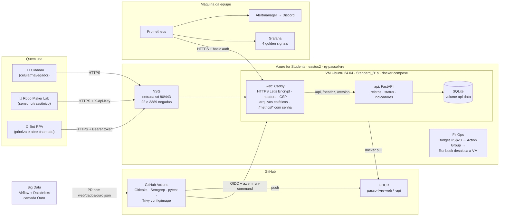

# Arquitetura do Passo Livre

## Visão geral

## Componentes

| Componente | Tecnologia | Responsabilidade |
|---|---|---|
| **web** | Caddy 2.11 (imagem própria, não-root) | Serve o front-end estático, termina TLS (Let's Encrypt), aplica headers de segurança e CSP, faz proxy para a API, expõe métricas Prometheus protegidas por basic auth, registra logs **sem IP**. |
| **api** | Python 3.12 · FastAPI · SQLite | Relatos (criar, listar, confirmar), atualização de status pelo RPA (token), relatos do robô (token), indicadores, `/healthz`, `/version`, `/metrics`. SQL sempre parametrizado. |
| **front-end** | HTML/CSS/JS sem framework + Leaflet 1.9.4 (vendorizado) | Mapa + lista acessível, formulário de relato com GPS/centro do mapa, rascunho offline com reenvio, tela de distritos (Ouro), páginas "Como funciona" e "Privacidade". |
| **infra** | Terraform (azurerm 4, azuread 3) | RG, VNet, NSG, IP com DNS, VM com cloud-init, OIDC do GitHub, trava de gasto. State remoto em Azure Storage. |
| **pipeline** | GitHub Actions | Varreduras de segurança, testes, build, publicação no GHCR, deploy e smoke test. |
| **observabilidade** | Prometheus 3.16 · Alertmanager 0.35 · Grafana 13.2 | Coleta, alertas e dashboard das 4 golden signals (roda localmente, apontando para a URL pública). |

## Decisões de arquitetura (ADRs resumidos)

1. **VM única com docker compose, em vez de serviços gerenciados.** É a opção mais barata para o MVP
   (B1s ≈ US$ 7,6/mês), usa o mesmo `docker-compose.yml` local e na nuvem e atende "stack sobe com docker compose".
   Próximo passo de escala: Azure Container Apps + PostgreSQL Flexible (ver custos).
2. **SQLite em volume.** Volume de escrita baixo, um único nó e backup simples do arquivo. Troca para PostgreSQL
   só se houver mais de um nó.
3. **Sem SSH.** A porta 22 é negada no NSG; administração e deploy usam `az vm run-command`, autenticado
   pelo Entra ID e auditado no Activity Log.
4. **Deploy por OIDC.** O GitHub Actions não guarda senha da Azure: troca o token OIDC do workflow por um token
   da Azure com permissão **apenas na VM** (Virtual Machine Contributor no escopo da VM).
5. **Caddy na borda.** Faz HTTPS automático sem certbot, aplica headers e exporta métricas de latência,
   tráfego e erros por código, o que dá as golden signals para qualquer formato de front-end.
6. **Componentes das outras disciplinas por contrato.** RPA e robô usam a API com tokens próprios; o Big Data
   entrega um JSON agregado da camada Ouro; Visão e GenAI não rodam neste servidor (custo de RAM/GPU).

## Fluxo de um relato

1. O cidadão escolhe o tipo, marca o local (toque, GPS ou centro do mapa) e envia → `POST /api/relatos`.
2. O relato aparece no mapa e na lista como **Novo**. Vizinhos podem confirmar ("Também vi isso").
3. O bot de RPA consulta `GET /api/relatos?status=novo`, deduplica, prioriza e chama
   `PATCH /api/relatos/{id}` com status, prioridade e protocolo. Cada mudança entra no histórico.
4. O cidadão acompanha a evolução: novo → em análise → encaminhado → resolvido.
